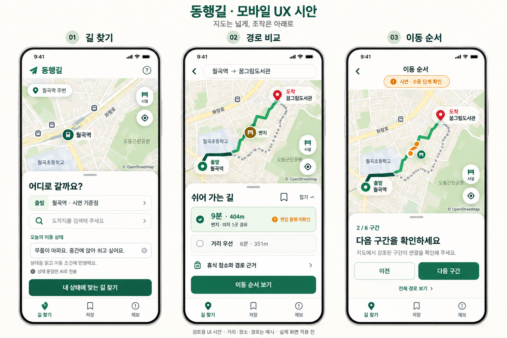

# 동행길 모바일 UX 검토 시안 v1

작성: 2026-11-01 (Asia/Seoul). 상태: 사용자 검토용, 앱 적용 전.

후속 상태: 사용자가 시안 방향을 승인해 실제 모바일 UI를 적용했다. 아래는 당시 시안의 기록이며, 최신 구현·검증과 실제 화면은 [모바일 UX 구현 기록](../mobile-ux-implementation.md)을 참고한다.

## 요청과 문제

사용자가 현재 모바일이 PC 웹사이트처럼 느껴진다고 지적하고, 실제 수정 전에 이미지로 방향을 검토하고 싶다고 요청했다. 현재 화면은 PC 헤더·소개·입력·결과를 세로로 쌓아 지도와 입력 사이를 오가는 스크롤이 길고, 중요 버튼과 정보가 분산된다.

## 제안 방향

- 지도 중심의 고정된 화면과 접을 수 있는 하단 패널을 사용한다. 화면 상태는 길 찾기 → 경로 비교 → 이동 순서로 전환한다.
- 처음에는 목적지·상태 문장·길 찾기를 하나의 하단 패널에 배치한다. 키보드 입력 중에는 패널을 확장하고 키보드가 버튼을 가리지 않도록 구현 단계에서 검증한다.
- 사용자가 하단 패널을 접으면 지도를 넓게 볼 수 있도록 한다. 드래그 외에도 명시적인 펼치기·접기 버튼을 제공한다.
- 결과에서는 시간·거리·휴식 경유·미확인 안내를 먼저 보여주고, 선택 근거·전체 구간·상세 경사는 펼쳐 확인하게 한다. 기존의 큰 지도 위 안내창을 별도로 중복 표시하지 않는다.
- ‘길 찾기 / 저장 / 제보’를 하단 탭으로 모은다. 시설은 지도 위 작은 버튼으로 열어 개별·전체 토글을 제공한다. PC 발표·비교 시연 버튼은 기본 모바일 화면에서 보조 메뉴로 옮기는 방향이다.
- 터치 영역·본문 글자를 키우고 하단 안전 영역을 고려한다. 녹색 브랜드, 현재 경로 정책과 데이터의 불확실성 구분은 유지한다.

## 세 화면

1. **길 찾기:** 시연 기준점과 실제 GPS를 구별하는 출발 표시, 목적지 검색, 자연어 상태 입력, 한 번의 길 찾기. 경로 조건·AI 활성화 체크박스를 추가하지 않는다.
2. **경로 비교:** 쉬어 가는 경로와 거리 우선 비교, 접이식 근거, 저장과 이동 순서 진입. 접근성 제약이 있는 경우 비교 경로 표시 여부는 기존 엔진 정책을 따른다. 조건을 만족하지 못한 경로는 위험 대안으로 표시해야 한다.
3. **이동 순서:** 현재 가능한 수동 구간 확인 흐름을 모바일에 맞게 정리한다. 시안은 자동 GPS 회전 안내 구현을 뜻하지 않는다. 실제 GPS 이동 확인과 시뮬레이션의 구별도 유지해야 한다.

## 시안의 범위

이 이미지는 내장 image_gen 도구로 만든 디자인 검토용 목업이다. 지도·지명 배치·경로·거리·시설 위치는 예시이며 실제 지도 또는 통행 가능 근거로 사용하지 않는다. 한글의 작은 자형·아이콘·화면 비율은 실제 HTML 구현 시 확정한다. ‘현장 통행 미확인’ 등 주의 문구는 실제 앱에서 읽을 수 있는 크기로 제공해야 한다.

실제 앱 소스, HTML 3종, 서버, API 설정은 이번 작업에서 변경하지 않았다. 이미지의 시각 검토와 파일 저장만 수행했으며 모바일 기능·제스처·키보드 동작을 구현·검증한 결과가 아니다. 사용자 의견을 받은 뒤 실제 화면 수정과 모바일 브라우저 검증을 진행한다. 외부 배포·커밋·푸시는 수행하지 않았다.

## 산출물

- [시안 이미지](mobile-ux-v1.png)
- [최종 이미지 생성 프롬프트](prompt-v1.txt)
- 참고한 현재 화면: [기존 모바일 검증 화면](../final-mobile.png)

생성 방식: 내장 image_gen, 기존 모바일 화면을 브랜드·기능 맥락의 참고 이미지로 사용. CLI/API fallback은 사용하지 않았다.
