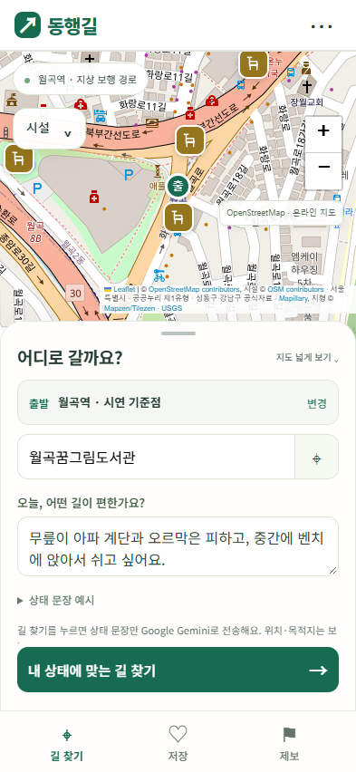
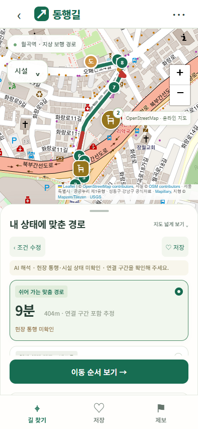
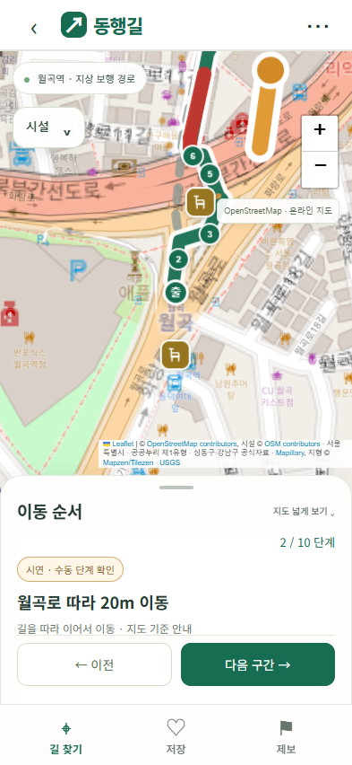

# 모바일 앱 형태의 UX 적용

적용일: 2026-11-01, Asia/Seoul. 사용자가 [모바일 시안 v1](mobile-ux-concept/README.md)을 승인해 실제 UI에 적용했다.

## 화면과 조작

- 화면 너비 700px 이하: 지도 전체 화면 위에 하단 패널과 길 찾기·저장·제보 탭을 배치한다. PC의 두 열 계획 화면·발표 기능은 유지한다.
- 입력·결과·이동 순서·저장 상태를 전환한다. 출발지 설정과 자연어 예시는 접어서 공간을 줄인다. 출발점의 시연 기준점/GPS 구분을 유지한다.
- 패널 제목의 버튼으로 접기/펼치기, 손잡이 위로 밀기로 확장할 수 있다. 패널 손잡이 외 영역의 지도 드래그와 패널 내부 스크롤은 서로 구분한다.
- 키보드 포커스 시 패널을 확장한다. visualViewport 높이·오프셋을 반영해 OS 키보드가 차지하는 영역에 화면이 가려지지 않도록 처리하고, 포커스 필드를 패널 안으로 스크롤한다. 모바일 입력 글자는 16px 이상으로 설정했다.
- 결과는 시간·거리·미확인 상태를 먼저 보여주고 상태 해석·경사·연결·메시지 근거는 펼쳐 확인한다. 위험 대안과 휴식 미충족 안내는 결과 상단에 유지한다. 기기 내 해석과 AI 해석도 구분해 표시한다.
- 이동 순서 보기 버튼은 결과 패널 하단에 고정한다. 순서 화면은 시연·수동 단계 확인이라고 표시한다. 상세 대화상자의 기존 시뮬레이션·GPS 이동 확인도 접근 가능하다.
- 시설 컨트롤은 작은 버튼으로 열고, 열릴 때 패널을 접는다. 모바일에서 지도 위 별도의 경로 안내창·제보 버튼·PC식 소개·시설 집계를 중복 표시하지 않는다.
- 지도 맞춤 범위를 하단 패널·탭 높이와 연동한다. 처음 출발 핀과 GPS 위치도 가려진 중앙이 아닌 보이는 지도 영역에 맞춘다.
- 작은 화면, 가로 화면, 안전 영역과 PC로의 크기 전환을 고려했다. 메뉴에서 이용 안내·비교 시연·월곡역 복원을 제공한다.

## 실제 구현 화면

아래는 이미지 생성 시안이 아닌 구현 화면의 Chrome 캡처다. 경로는 시연 입력의 계산 결과이며 현장 통행 검증 근거가 아니다.

| 입력 | 결과 | 이동 순서 |
| --- | --- | --- |
|  |  |  |

## 변경 파일

- `dist/index.html`: 패널·탭·메뉴, 출발지·근거·구간 목록의 접이식 구조.
- `dist/style.css`: 모바일 고정 화면, 패널·안전 영역·터치 UI와 데스크톱 표시 규칙.
- `dist/app.js`: 화면 상태·패널 제스처·입력 포커스·지도 맞춤 범위·탭·저장·제보 연결.
- `scripts/build-html.py`: 빌드 버전 `2026-11-01-mobile-app-shell`.
- `scripts/test-mobile-app.cjs`: 모바일 통합 검사 추가.
- `scripts/test-final-ui.cjs`, `test-auto-plan-ui.cjs`, `test-map-tiles.cjs`: 새 모바일 메뉴·패널 진입 경로 반영.
- 최종·시연·전달용 HTML 3종, `docs/final-build.json`과 관련 검사 결과·화면, 최상위 README·수정이력·전달 검증 기록 갱신.

## 확인한 내용

- [모바일 검사 결과](mobile-app-results.json): 실제 Chrome 터치 이벤트로 지도 이동·패널 손잡이 제스처, 검색·자동 AI 요청, 상세 근거, 수동 이동 순서, 저장·다시 찾기, 제보 저장, 시설 토글과 경로 독립성, 없는 검색 결과, 지도 출발 핀, AI 실패 시 기기 내 해석, 오프라인 단일 HTML 확인.
- 320×568, 393×852, 430×932와 가로 667×375 크기를 검사했다. 가로 넘침과 패널 버튼의 화면 내 위치를 확인했다.
- 키보드 대응 분기는 visualViewport 높이를 모의로 바꿔 검사했다. 실제 OS 키보드를 열어 확인한 검사가 아니다.
- [자동 추천 UI 검사](auto-routing-ui-results.json): 자동 상태 해석·중복 요청 방지·오래된 응답 취소·실패 후 재시도·저장 재검색·휠체어 조건·기존 PC 발표 기능 통과.
- [시연 UI 검사](final-ui-results.json): 경로 3종, 순서·시설 팝업·토글·저장·시뮬레이션·모바일 탭·GPS 권한 거부 처리 통과.
- [지도 검사](map-tiles-results.json): 실제 OSM 타일·Referer, 단일 배경, 지도 이동·휠 확대·축소, 통신 실패·내장 지도·재연결, 모바일 패널 크기 변화, 분리 소스·단일 HTML 확인.
- JS 문법·빌드 지형 입력 해시 검증, HTML 3종 해시 일치, API 키 미포함 확인. 위 브라우저 검사에서 스크립트 오류 0건.

AI UI 검사는 모의 Gemini 제공자를 사용했으며 사용자 키로 외부 AI 호출을 하지 않았다. OSM 타일 검사는 실제 타일 연결을 포함한다. 실제 휴대폰 Safari/Chrome, OS 키보드, 현장 GPS·통행 가능 여부는 별도 확인이 필요하다. 경로 엔진·지형 정책·시설 원본은 이번 UI 작업의 수정 대상이 아니다. 커밋·푸시·외부 배포는 수행하지 않았다.
