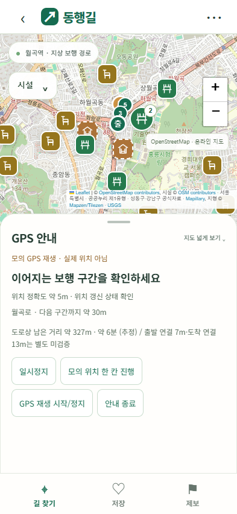
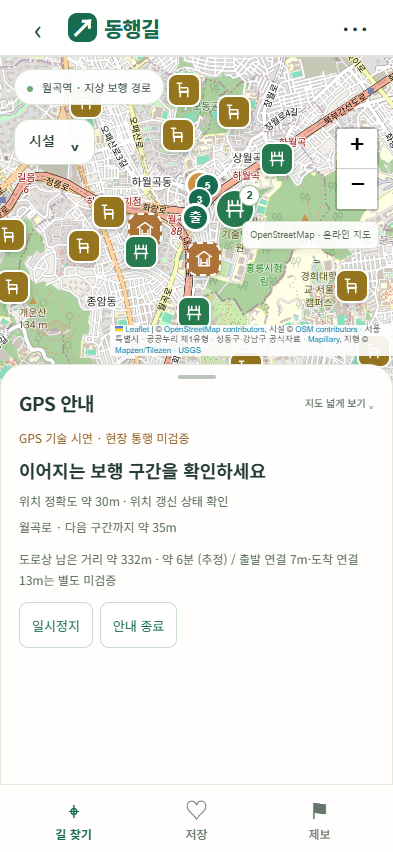

# 내비게이션 구현 현황 — GPS 기술 시연

작성: 2026-11-01, Asia/Seoul. [구현 계획](../../내비게이션-구현계획.md)에 따라 소프트웨어를 구현했다. 이후 사용자가 갤럭시 S21·Chrome에서 위치 오차 약 24~25m를 보고했다. 이는 정확도 표시 관찰이며 전체 보행·이탈·도착 검증 완료를 의미하지 않는다.

## S21 관찰에 따른 위치 품질 기준 조정

일반 자동 진행 후보의 허용 오차를 25m에서 35m로 넓혔다. 표시값이 약 25m 부근에서 오르내리는 경우를 고려한 시험값이며, 실제 위치 정확도를 개선하거나 보행 연결을 검증한 변경은 아니다.

| 처리 | 현재 정확도 조건 |
| --- | --- |
| 일반 진행·구간 전환 | 오차 35m 이하. 평행 도로·층위 모호, 위치 튐·지연 등 기존 조건도 통과해야 한다. |
| 오차 35m 초과~50m | 위치는 표시하되 자동 진행 보류. 안내 문구에 35m 기준을 표시한다. |
| 오차 50m 초과 | 큰 오차로 자동 진행 보류. |
| 경로 이탈 확정·재탐색 | 별도 25m 이하 기준 유지. 일반 진행 범위를 넓혀도 덜 정확한 위치로 경로를 바꾸지 않는다. |
| 목적지 인근·도착 확인 | 15m 이하와 목적지 근접·5초 유지·사용자 확인 조건 유지. |

정책은 `navigation-policy.js`의 `goodAccuracy`, `offrouteAccuracy`, `rerouteAccuracy`, `arrivalAccuracy`로 구분한다. 조정 후 S21 재검사·iPhone 검사는 대기 상태다.

## 바로 확인하기

1. 최상위 `동행길-실행.cmd`로 로컬 서버를 열거나 기존 실행 주소를 새로고침한다.
2. 목적지·상태 문장으로 길을 찾는다. ‘이동 순서 보기’는 기존 수동 확인, ‘GPS 안내 시작’은 위치 API를 사용하는 기술 시연, ‘경로 GPS 재생’은 실제 위치를 사용하지 않는 모의 재생이다.
3. 먼저 **경로 GPS 재생**을 권장한다. ‘모의 위치 한 칸 진행’으로 약 5m씩 진행하거나 ‘GPS 재생 시작/정지’로 자동 재생한다. 재생 시간은 실제 보행 시간과 다르다.
4. 위치 API를 사용할 때는 권한을 허용한다. PC 위치가 시연 지역 밖이면 길 안내가 연결되지 않을 수 있다. 이를 임의의 직선으로 연결하거나 시연 기준점을 실제 위치로 바꾸지 않는다.
5. 안내 패널에서 다음 구간·거리·GPS 상태를 보고 일시정지·다시 시작·종료를 선택한다. 휴식 지점·목적지 인근에서는 사용자 확인 버튼을 제공한다.

파일 단독 실행에서도 내장 데이터와 모의 재생을 사용할 수 있다. 실제 휴대폰의 GPS 검사는 아래 HTTPS 접속을 준비한 뒤 진행한다.

## 구현한 내용

| 구성 | 내용 |
| --- | --- |
| 계획·정책 | `navigation-plan.js`, `navigation-policy.js`: 선분·누적 거리·행동 지점·휴식·연결·자료 버전·프로필 스냅샷, 공간 격자 인덱스, 실험 정책값 |
| 위치 코어 | `navigation-core.js`: 유효/신선도/정확도/점프 검사, 선분 투영, 연결 이력·방향·층위에 따른 후보 비교, 모호 상태·정지 흔들림·되돌아감·이탈·지연·휴식·목적지 인근 판단 |
| 세션 | `navigation-session.js`: 위치 감시 한 개, 중단·재개·권한 오류·화면 숨김, 새 위치 재획득, 재탐색 단일 실행·세대 토큰·냉각 시간, 휴식·도착 사용자 확인 |
| 재탐색 | `navigation-routing.js`: 접근 가능한 가까운 간선 내부에 임시 시작점을 추가한 복제 그래프로 계산. 원본 그래프·엔진 파일은 바꾸지 않는다. 먼 연결·모호한 평행 간선·확정할 수 없는 층위는 거부한다. 사용자 프로필은 보존하고 완료된 휴식만 남은 계획에서 제외한다. |
| 표시 | `navigation-ui.js`와 기존 `app.js`: GPS/모의 배지, 원시 위치 핀과 정확도 원, 지나온 경로, 다음 구간·잔여 거리, 수동 재탐색·일시정지·종료·휴식·도착 확인. 지도 드래그/확대 시 따라가기를 풀고 현재 위치로 버튼으로 복귀한다. |
| HTTPS 개발 준비 | `scripts/serve-navigation-https.mjs`: 지정한 사설 IP와 사용자가 신뢰한 인증서로 실행. 12자 이상 암호 환경변수와 HTTP Basic 인증을 요구하고 키 설정 화면·API 변경은 차단한다. |

단순 최근접 노드를 기준으로 진행도를 계산하던 `startTracking()`은 새 세션 진입으로 교체했다. 기존 수동 순서·시뮬레이션·조건 해석·시설·저장·제보는 유지한다. 정밀지도나 새로운 시설 위치를 생성한 작업은 아니다.

실제 GPS 원본과 경로에 매칭한 위치를 구별한다. 사용자 위치와 이동 로그는 서버·Gemini로 보내거나 자동 저장하지 않는다. 모의 재생에서는 화면에 실제 위치가 아니라고 계속 표시한다.

## 제공 범위와 보류 사항

- **현재 모든 GPS 안내는 기술 시연**이다. 현장 검증된 경로로 선언하는 모드는 제공하지 않는다. `fieldVerified`는 false다.
- 위험 대안(`assistancePreview`)은 일반 GPS 시작을 제한하며 모의 재생은 가능하다. 경사 기준을 만족하지 못한 경로를 정상적인 독립 이동 안내로 바꾸지 않는다.
- 자동 다음 구간·잔여 거리 갱신과 지속 이탈 검사는 구현했다. 자동 재탐색 실행 경로도 모의 검사로 검증했지만, 계획대로 실기기 검토 전에는 `autoReroute:false`를 유지한다. 현재 UI에서는 신선하고 충분히 정확한 위치가 있을 때 **현재 위치에서 다시 찾기**로 명시적으로 실행한다.
- 휴식 장소는 가까워졌다고 완료 처리하지 않는다. 여기서 쉬기→이동 재개 또는 지나가기·이용 어려움을 선택한다. 지나가기는 휴식 완료가 아니며, 이용 어려움은 세션의 후보 제외 기록으로만 처리한다.
- 목적지 인근은 위치 품질·잔여 거리·횡방향 거리·대기 시간을 함께 확인하고 **도착 확인**으로 종료한다. 학교 대표점의 미검증 연결을 확인된 출입구로 바꾸지 않았다.
- 화면 잠금·백그라운드 연속 안내는 제공하지 않는다. 숨김 시 감시를 중지하고 재개 때 새 표본을 기다린다. 브라우저의 위치 전달·실행에는 수명주기 제약이 있다. [W3C Geolocation](https://www.w3.org/TR/geolocation/), [Chrome 페이지 수명주기](https://developer.chrome.com/docs/web-platform/page-lifecycle-api).
- 화면 유지·음성·진동·실시간 시설 운영 정보는 이번 버전에 연결하지 않았다. 연속 휴식 일정과 네이티브 백그라운드 안내도 후속 과제다.

## 실제 Android·iPhone 접속 준비 — 나중에 실행

현재 서버의 PC localhost 주소는 휴대폰에서 그 PC를 가리키지 않는다. 휴대폰에서는 신뢰된 HTTPS 개발 접속을 준비해야 한다. 이 작업에서는 인증서를 생성·설치하거나 LAN 서버·외부 배포·방화벽 변경을 실행하지 않았다.

준비:

1. 두 휴대폰과 PC를 신뢰할 수 있는 같은 Wi-Fi에 연결한다.
2. PC의 사설 IPv4와 해당 IP를 포함한 개발 서버 인증서·키를 준비한다. 예를 들어 [mkcert 공식 안내](https://github.com/FiloSottile/mkcert)를 따를 수 있다. PC뿐 아니라 각 휴대폰이 발급 CA를 신뢰하도록 직접 설정해야 한다. 루트 CA의 **개인 키는 휴대폰에 복사하지 않는다**.
3. 인증서·키는 `.local-https/` 등 Git 제외 위치에 둔다. 실제 암호·API 키·개인 이동 로그는 커밋하지 않는다.
4. 아래 사설 IP와 파일 경로는 실제 환경 값으로 바꾼다. IP `192.168.0.10`은 예시다. 관리자 권한·방화벽 허용이 필요한 경우 필요한 앱과 사설 네트워크 범위만 확인한다.

PowerShell에서 사용자가 직접 실행:

```powershell
$securePassword = Read-Host '휴대폰 접속 암호 (12자 이상)' -AsSecureString
$env:DONGHAENG_HTTPS_PASSWORD = [System.Net.NetworkCredential]::new('', $securePassword).Password
node donghaeng-nav/scripts/serve-navigation-https.mjs --host 192.168.0.10 --port 8443 --cert .local-https/dev-cert.pem --key .local-https/dev-key.pem
```

휴대폰에서 출력된 HTTPS 주소를 연다. 로그인 사용자명은 `donghaeng`, 암호는 방금 입력한 값이다. 인증서 경고를 무시해서 진행하지 말고 신뢰·IP 일치를 확인한다. 설정 종료 후 서버는 Ctrl+C로 닫고 해당 PowerShell 세션에서 환경변수를 정리한다. 키 설정은 기존 PC localhost의 `/setup`에서 수행한다. 휴대폰 HTTPS 서버는 `/setup`·`/api/config` 변경을 허용하지 않는다.

검증 현황: 암호 비교와 사설 IP 검사는 통과했다. 실제 인증서로 두 휴대폰을 연결한 검사는 아직 수행하지 않았다.

## 검사 결과

- [코어·세션·라우팅](navigation-core-results.json): 긴 선분 내부 진행, 정지 흔들림, 위치 튐/역순, 낮은 정확도·지연, 지속 이탈·나쁜 표본의 이탈 근거 초기화, 평행/층위 모호, 되돌아감, 반대편 도로 도착 억제, 휴식 명시 확인·계획된 미검증 휴식 연결, 중단/오래된 콜백, 위험 대안 시작 제한, 복귀 재획득, 간선 내부 재탐색, 같은 프로필 유지·위험 대안 거부, 시험용 자동 재탐색의 단일 실행을 검사했다.
- [브라우저 UI](navigation-ui-results.json): Chrome 모바일·PC에서 GPS 재생·일시정지/재개/종료, 위치 API 어댑터, 실제/모의 표시, 모션 공존, 재탐색 중 일시정지의 화면 경로 보호, 위험 대안 시작 제한, 작은 화면, 단일 HTML 오프라인 재생 통과.
- 브라우저 위치 API는 **가상 좌표와 권한 설정**으로 검사했다. 실제 휴대폰·물리 GPS 성능을 검증한 것은 아니다. AI는 모의/연결 실패 대체만 검사했고 사용자 키로 Gemini를 호출하지 않았다.
- 기존 `test-condition-api.mjs`, `test-auto-plan-ui.cjs`, `test-mobile-app.cjs`, `test-final-ui.cjs` 회귀 검사 통과. 브라우저 스크립트 오류 0건. 빌드 시 기존 지형 입력 해시 검증을 유지한다. HTML 3종의 해시·모듈 내장과 키 미포함을 확인한다.





## 계획 대비 상태

| 단계 | 상태 |
| --- | --- |
| 0. 자료·출입구·두 기기 실행 환경 | 코드·HTTPS 실행 도구·[현장 점검표](navigation-field-review.csv) 준비. 인증서 신뢰·실기기 연결·현장 조사는 대기 |
| 1. 위치 코어·세션·재생 | 구현·합성/브라우저 검사 완료 |
| 2. 선분 매칭·진행도·시작 스냅 | 구현·합성 검사 완료. 실제 보도·층위 확인 대기 |
| 3. 자동 다음 구간·화면 | 기술 시연 구현·브라우저 검사 완료. 실제 회전 안내 현장 대조 대기 |
| 4. 이탈·재탐색 | 수동 재탐색 제공. 자동 실행은 코어 검사만 완료, 실기기·현장 검사 전 기본 보류 |
| 5. 휴식·도착 확인 | 명시적 사용자 확인 흐름 구현·코어 검사 완료. 실제 시설·출입구 대조 대기 |
| 6. Android/iPhone·현장 검증 | 사용자 요청에 따라 나중에 진행 |

이 버전을 현장 사용 가능한 내비게이션 최종 완료로 표시하지 않는다. 기존 잘못된 경로·정밀지도 미확보·출입구 미검증 문제는 여전히 별도 검증 대상이다. 이번 작업의 커밋·푸시는 요청받기 전 수행하지 않았고, 외부 배포도 하지 않았다.
