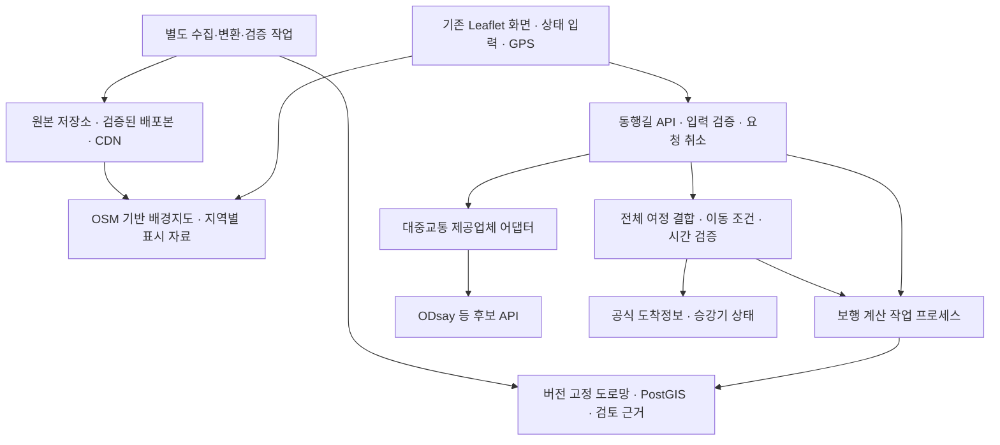

# 동행길 서울 전역 보행·정밀지도·대중교통 확장 계획

작성: **2026-11-11 KST**. 기준 커밋: `373c51208d81b17257c930c328dfa75748253f0e`, 브랜치: `feature/gemini-route-selection`.

상태: **계획서 작성 완료 / 확장 기능 구현 전**. 사용자의 지침에 따라 네이버 지도 API·SDK·검색·길찾기·타일을 사용하지 않는다. 기존 OSM·Leaflet과 자체 보행 계산을 유지하고 공식 정밀자료 및 별도 대중교통 API를 연결한다. 이 문서는 구현·자료 확보·현장 검증·서비스 계약이 완료됐다는 뜻이 아니다.

후속(2026-11-11): 사용자의 실행 요청으로 구현을 시작했다. 위 상태와 본문의 구현 전 설명은 계획 작성 당시의 기록으로 보존하며, 현재 완료·부분 완료·남은 작업은 [확장 구현 현황](seoul-expansion-progress.md)을 우선한다. ODsay 키는 사용자가 보유하며 Vercel 환경변수에 설정할 예정이다.

## 1. 목표와 제공 범위

상태 문장과 출발·목적지를 입력하면 서울 전역에서 도보 또는 버스·지하철을 조합한 이동 후보를 비교한다. 동행길은 각 후보의 도보 거리·계단·참고 경사·휴식·출입구 및 환승 연결의 확인 수준을 설명한다. 대중교통을 추가해도 기존의 필수 이동 조건을 자동으로 완화하지 않는다.

다음 네 가지 범위를 각각 관리한다. 서울 전체 지도가 표시된다는 이유로 정밀자료나 접근성 검증도 서울 전체에 적용됐다고 표시하지 않는다.

| 범위 | 목표 | 완료 판단 |
| --- | --- | --- |
| 지도·시설 표시 | 서울 전역 | 지도 영역별 자료 로딩과 출처 표시, 누락 범위 표시 |
| 일반 보행·대중교통 탐색 | 자료가 준비된 서울 구간부터 전역으로 확대 | 지역 간 연결·시간·정류장 식별자·장애 시 처리 검증 |
| 공식 정밀자료 반영 | 월곡 시범 구간 → 인접 지역 → 확보 가능한 전역 | 도엽 목록·유효 범위·좌표계·원본 및 변환 검증 |
| 접근성 현장 검증 | 조사한 보행·역·환승 구간을 누적 확대 | 조사 시점·항목·대상 조건·제한을 갖춘 구간별 기록 |

서울 밖으로 나갔다 돌아오는 수도권 대중교통 후보는 별도로 표시한다. 경기도·인천의 보행 연결이나 운영기관 자료가 없으면 서울과 같은 확인 수준으로 취급하지 않는다.

## 2. 현재 출발점

| 항목 | 현재 확인한 상태 | 확장 시 필요한 일 |
| --- | --- | --- |
| 보행 엔진 | 월곡역 주변 OSM 도로망, 경사/계단/휴식 조건, 선분 연결·건물 겹침 검사 | 서울 도로망 수집·검증, 서버 계산, 지역 경계 연결 |
| 정밀지도 | 기존 1:1,000 변환본 16도엽·16,169도형 | 원본 DXF/XML 재입수·대조, 도엽별 확대, 보행 연결 검증 |
| 도형 구성 | 인도 경계 798, 도로 경계 3,393, 건물 10,979, 등고선 951, 표고점 48 | 경계를 보행 중심선·횡단·출입구로 자동 확정하지 않기 |
| 정밀자료 좌표계 | EPSG:5186 추론·교차 확인, 수직 기준 미확인 | 새 원본별 명시 기준 확인, 기준이 불명확한 높이 자료 보류 |
| 별도 표고 근거 | 기존 원본의 표고점 944·등고선 191을 도로 참고 근거로 연결 | 정밀지도 도형 수와 별도 집계, 보도 경사로 승격 금지 |
| 서울 시설 | 17,485개 등록 기록, 공식 쉼터 4,092곳 대조 | 현재 운영·출입·좌표 역할을 보존하며 갱신 |
| 초기 준비 | 필수 압축 자료 약 5.58MB, 느린 로컬 모의 검사 약 18초 | 서울 자료 전체를 브라우저에 넣지 않도록 구조 변경 |
| 대중교통 | 버스·지하철 통합 탐색 미구현 | 후보 API·운행정보·접근성 연결 추가 |
| GPS | 품질 필터·따라가기·기술 시연, 자동 재탐색 기본 비활성 | 실기기·현장 검증 후 별도 활성화 판단 |

현재 수치는 [수정·검증 기록](audit-fixes.md), [빌드 기록](final-build.json), `dist/data/precision/precision-map.geojson` 기준이다. 약 18초는 로컬 Node·4Mbps/80ms·CPU 4배 감속의 단일 모의 측정이며 실제 휴대폰·Vercel 성능이 아니다. 기존 좌표·경사값과 `research/`는 보존한다.

## 3. 채택할 구조

| 역할 | 기본 선택 | 선택 이유·보류 사항 |
| --- | --- | --- |
| 화면 | 기존 Leaflet 유지 | 모바일 패널·시설·GPS·정밀 레이어 재사용. 대규모 렌더링 결과에 따라 벡터 타일 지원을 후속 검토 |
| 배경지도 | OSM 기반 타일 | 서비스 규모에 맞는 타일 제공업체 또는 자체 호스팅 선택. 공용 OSM 서버를 대량 수집용으로 쓰지 않음 |
| 보행 계산 | 기존 순수 엔진을 서버 작업 프로세스로 옮겨 검증 | 사용자 조건·휴식·기하 보호를 재사용. 전역 성능이 부족하면 공간 인덱스/탐색 최적화부터 적용 |
| 정밀자료 저장·검색 | PostgreSQL/PostGIS, 원본 객체 저장소 | 원본·출처·기하와 배포본을 분리하고 영역 조회·검증 지원 |
| 대중교통 후보 | ODsay 우선 타당성 검토 | API 문서는 확인했으나 계약·지도 병용·결과 가공·저장 조건과 실제 키 호출은 미확인 |
| 실시간 정보 | 서울시·운영기관 공식 API | 도착정보·차량 유형·승강기 상태 등 항목별로 실제 제공 범위를 확인 |
| 주소·장소 검색 | 보유 시설·OSM POI·사용 가능한 공식 주소 자료의 서버 검색 | 한글 별칭·도로명/지번·다중 결과·검색 범위 처리. 자체 Nominatim 등은 용량 측정 후 선택 |
| 웹 배포 | Vercel 화면·가벼운 API 중계 유지 | 큰 전역 그래프·수집 작업·상주 계산은 별도 백엔드에 배치 |

ODsay를 쓸 수 없으면 다른 대중교통 제공업체를 같은 인터페이스로 비교한다. 공공 도착정보만으로 완성된 환승 길찾기를 대체할 수 있다고 가정하지 않는다. 자체 대중교통 엔진은 GTFS 또는 동등한 운행·정류장·달력·환승 자료의 확보 및 이용조건 검증 이후 별도 범위로 산정한다. 국내 대상 자료가 이미 GTFS로 제공된다고 전제하지 않는다.

그림의 API·저장소·작업 프로세스는 예정 구성이다. Vercel의 기존 `/api/analyze-condition`, `/api/select-route`는 유지하고, 장시간 작업이나 전역 그래프 전체 적재를 현재 함수 안에서 수행하지 않는다.

## 4. 자료 수집·정규화 계획

| 자료 | 수집·처리 | 반드시 확인할 것 |
| --- | --- | --- |
| OSM 서울 도로·보행·시설 | 허용된 지역 추출본을 우선 검토, 관계·노드·태그 포함. 필요 시 작은 변경 범위 조회 | 스냅샷 기준 시각, 보도/출입 제한/계단/층위, 서울 경계 밖 연결 지원 객체 |
| NGII 1:1,000 | 도엽 인덱스 작성 → 원본 DXF/XML 확보 → 좌표·분류·겹침 대조 | 도엽별 촬영/측량/고시일, 정확도·좌표계·수직 기준·이용조건. 전역 원본 확보는 아직 미완료 |
| 서울 표고·DEM | 기존 원본 보존, 새 자료를 별도 수집해 해상도·수직 기준·구조물 영향 비교 | 지형 고도와 보도 노면 경사 구분. 빈 값을 0으로 채우지 않음 |
| 횡단보도·보도·출입구 | 공식 시설·OSM·현장 근거를 별도 대조 | 점 하나를 양 끝 보도 접속이나 실제 출입문으로 확정하지 않음 |
| 버스·지하철 | 노선·정류장·역·방향·운행일·시간표, API 식별자 대응표 작성 | 같은 역의 노선별 코드, 정류장 양방향, 승차/하차/역 출입구 구분 |
| 실시간·접근성 | 도착정보, 승강기 위치·시작/종료층·상태, 차량 유형 | 갱신 시각·유효시간·운영기관 범위·미수신/고장/상태 미확인 구분 |
| 쉼터·벤치 | 기존 근거·운영 충돌 보존, 폐쇄/추가/시간 변경 대조 | 시설 대표점·입구·의자 좌표 구분, 도착 시각의 운영·대상 제한 |
| 장소·주소 | 이용 허용 자료의 이름·별칭·주소 인덱스 생성 | 동일 이름 시설·층별 시설·검색 좌표의 역할, 이용조건 |

모든 수집 단위에 `source_id`, 공식 URL, `collected_at`, `source_as_of`, 발행/측량 시각, 원본 좌표계·수직 기준, 원본 SHA-256, 변환 버전, 유효 영역, 이용조건, `field_verified`와 근거를 기록한다. 자료 기준일·측량일·수집일·API 관측 시각은 별도 필드로 두며 미확인은 null과 사유로 남긴다. 실시간 자료에 측량일을 억지로 요구하지 않는다.

원본은 불변 보관하고 파생본은 버전별 생성한다. 서로 다른 높이 기준을 맞추지 않은 채 평균하거나 신규 경사를 계산하지 않는다. API 시간 초과·403·503·빈 응답·부분 다운로드는 실패 원문과 요청 식별자를 남기며 정상 자료로 넣지 않는다. 기존 research 폴더는 수정하지 않고 새 조사 폴더를 만든다.

OSM 도로망을 바꾸면 기존 지형·표고 근거의 그래프 해시 연결을 다시 검증한다. ID가 같다는 이유로 과거 근거를 새 선분에 그대로 붙이지 않는다. GIS·라이선스가 서로 다른 원본과 대응표를 분리하고 ODbL 파생 데이터 의무 및 공식 자료의 재배포 조건을 배포 전에 검토한다.

## 5. 정밀지도에서 보행 연결로 발전시키는 순서

1. **시범 구간 지정:** 월곡역과 주변 주요 목적지·쉼터·정류장을 잇는 조사 구간을 먼저 정한다. 지역은 검증 범위이며 엔진에 지명·방향·우회 정답을 하드코딩하지 않는다.
2. **기하 대조:** 공식 보도 경계·건물·OSM 선형의 중복, 틈, 좌표 차이, 도엽 경계를 조사한다. 수동 평행 이동으로 맞추지 않는다.
3. **연결 후보 생성:** 도로 양쪽 보도, 횡단 끝점, 출입구, 계단, 경사로, 승강기, 지상/지하 층위를 별도 객체로 구성한다. 기하에서 생성한 중심선은 검토 후보로 표시한다.
4. **통행 속성 검증:** 출입 제한·운영시간·최소폭·턱·층위를 근거별로 부착한다. 지도에 없는 연결은 빈칸으로 남기며 건물·담장·차도·다른 층을 최근접 직선으로 연결하지 않는다.
5. **공통 엔진 반영:** 검토를 통과한 연결만 버전 고정 그래프에 포함한다. 경로에 쓰이는 속성의 확인 수준은 각기 유지한다. 연결 검토 통과와 현장 검증은 별개다.
6. **지역 확대:** 인접 구역과 자치구 경계를 넘는 검사를 통과한 뒤 확대한다. 도엽·구역별 누락률, 연결 보류 사유와 조사 대상을 공개한다.

정밀자료 표시 범위, 보행 그래프 반영 범위, 속성별 확인 범위, 현장 조사 범위를 화면에서 각각 조회할 수 있게 한다. 횡단보도 점·보도 경계만으로 무단 횡단이나 승강기 접근을 허용하지 않는다.

## 6. 서울 전역을 위한 로딩·계산 변경

- 브라우저는 현재 화면 영역과 확대 수준에 필요한 지도·시설·검토 도형만 요청한다. 격자와 여유 영역을 사용하고 이동 중 이전 요청을 취소·중복 제거한다. 초기에는 지역별 GeoJSON으로 시작하고 측정 후 정밀 레이어의 벡터 타일 전환을 판단한다.
- 지도 표시용 단순화 도형과 경로 검증용 원본 기하는 분리한다. 화면용 축약 도형을 건물 겹침·턱·보도 접속 검증 입력으로 쓰지 않는다.
- 경로 서버는 전역 연결을 유지한다. 구역 안에서만 찾다가 연결이 끊기거나 서울 경계를 가로지르는 경로를 놓치지 않도록 탐색 범위를 넓힌다. 검증 자료가 빠진 영역을 검증 완료로 취급하지 않는다.
- 필수 검증은 서울 전체 자료가 아닌 **요청 경로와 후보 연결에 필요한 자료**를 준비해 수행한다. 미로딩·손상·버전 불일치는 추천 실패/검토 필요로 반환한다.
- 공간 데이터는 PostGIS에서 관리하고 빈번한 경로 계산은 버전 고정 그래프·공간 인덱스를 작업 프로세스에 적재하는 방식부터 측정한다. 모든 요청마다 전체 그래프를 재생성하지 않는다.
- 장기 계산·재탐색은 요청 버전과 취소 토큰을 유지한다. `datasetVersion`, `graphVersion`, 이동 조건, 시간 기준이 다른 캐시를 섞지 않는다.
- 배포는 원본 수집 → 검증 → 파생본 생성 → 무결성 확인 → 배포 버전 교체 순서로 한다. 자료 묶음은 원자적으로 교체하고 직전 버전으로 복구할 수 있게 한다.

기존 단일 HTML 5개는 월곡의 제한된 오프라인 시연 패키지로 유지한다. 서울 전역·실시간 대중교통은 온라인 서비스로 제공하며 파일 하나에 전역 자료를 넣지 않는다. 오프라인에서 대중교통 실시간 정보가 작동한다고 표시하지 않는다.

## 7. 대중교통과 보행을 결합하는 규칙

### 7.1 후보부터 전체 시간 검증까지

1. 대중교통 제공업체에서 버스·지하철 후보를 받고 자체 데이터 모델로 변환한다. 원본 응답의 사용·보관은 허용 범위를 따른다.
2. 업체의 역 대표점이 아닌 실제 승차 정류장·진입 가능한 역 출입구를 매핑한다. 노선·진행 방향·보도 편·층위가 다른 후보를 구분한다.
3. **출발→승차 지점, 하차→목적지, 모든 도보 환승**을 같은 이동 조건으로 계산한다. 역 안의 개찰구·승강장·환승 동선은 실외 보행 엔진만으로 해결하지 않는다.
4. 계단 회피·휴식 경유·승강기 이용으로 늘어난 시간과 대기·출입 시간, 자료에 근거한 환승 여유를 전체 일정에 반영한다.
5. 바뀐 승차/환승 시각으로 실제 운행 가능 여부를 다시 검사한다. 서울 시간대·자정 이후 운행일·주말/공휴일·막차·실시간 지연을 다룬다.
6. 제공업체가 필요한 시각 기반 검증을 지원하지 않거나 연결 시간표를 확보하지 못하면 ‘환승 가능 확인 완료’로 추천하지 않는다. 예상 시간과 확인 실패를 표시하고 대체 API/데이터 확보 과제로 남긴다.
7. 시간·조건을 모두 통과한 후보를 비교한다. 도보 구간을 바꾼 뒤 원래 업체의 총 소요시간을 그대로 표시하지 않는다.

예: 엘리베이터 출입구까지 돌아가야 해서 역 진입이 6분 늘었다면, 추가 6분을 넣고 기존 열차·환승을 이용할 수 있는지 재평가한다. 그 열차를 놓친다면 다음 운행편 기준으로 전체 일정을 다시 계산하거나 후보를 제외한다.

### 7.2 접근성·휴식·실시간 상태

- 역에 엘리베이터가 있다는 정보만으로 지상→개찰구→승강장 및 환승의 전 구간이 이어진다고 판단하지 않는다. 승강기마다 출입구·연결 층·운영기관을 확인한다. 서울교통공사 API가 모든 수도권 운영기관을 포괄한다고 전제하지 않는다.
- 저상 차량 여부는 해당 도착편의 근거와 연결한다. 저상버스라는 이유만으로 정류장 보도·승하차 여건까지 검증됐다고 하지 않는다. 탑승 지원·혼잡·운행 변경은 별도 한계로 표시한다.
- 실시간 자료에 관측 시각과 유효시간을 두고, 고장/미수신/오래된 상태를 구분한다. 오래된 정상 상태를 현재 정상으로 계속 사용하지 않는다.
- 휴식 요구는 보행 구간과 전체 여정에서 보존한다. 차량 탑승·대기 시간을 자동으로 ‘앉아서 휴식 완료’로 계산하지 않는다. 다회 휴식 일정은 첫 휴식만 처리하는 현재 엔진의 별도 확장 작업이다.
- 필수 조건 위반과 조건을 확인할 수 없는 경우를 구분한다. 충족 근거가 없는 후보를 접근성 충족으로 승격하지 않는다. 조건 미충족 대안은 사용자가 선택한 검토용 화면에 두고 일반 추천·실제 GPS 시작과 분리한다.
- 제공업체가 반환한 후보를 검토한 결과와 전체 교통망의 최적해를 구분한다. 적격 후보가 없으면 ‘이번에 확보한 후보에서 조건을 확인할 수 없음’으로 설명한다. 추가 후보 탐색은 시간·계약·호출 예산 안에서 수행하고 전역에 가능한 경로가 전혀 없다고 단정하지 않는다.

### 7.3 안내와 AI의 역할

첫 대중교통 버전은 전체 여정과 단계별 수동 확인, 실외 보행 기술 시연을 제공한다. GPS만으로 승차·하차·지하 환승을 자동 확정하지 않는다. 실시간 승하차 감지·백그라운드 안내는 후속 범위다.

입력한 상태 문장은 기존 방식으로 자동 해석한다. 경로 조건 체크박스·별도 AI 실행 버튼을 추가하지 않는다. AI는 적격 후보 최대 5개의 익명 요약을 비교하며 지도 도형·정류장명·좌표를 보내지 않는다. 혼합 여정의 익명 요약 계약을 별도 검증한 후 적용한다. 추천 이유는 해당 여정 버전에 묶고 재탐색 시 무효화한다.

대중교통 검색에는 업체에 출발·도착 좌표를 보내야 할 수 있다. 이 전송은 Gemini의 좌표 미전송과 별도로 화면에서 설명한다. 연속 GPS 궤적을 제공업체나 AI에 자동 전송하지 않는다.

## 8. 구현 단위와 의존성

아래 경로와 API는 제안이며 아직 생성·구현하지 않았다. 실제 앱 소스는 계속 `donghaeng-nav/dist/`를 사용한다.

| ID | 작업·주요 산출물 | 의존 | 완료 기준 |
| --- | --- | --- | --- |
| P0 | `docs/seoul-source-catalog.*`, 도엽/권한/커버리지·비용·성능 기준선 | 없음 | 확보/미확보/접근 실패 구분, 대중교통·타일 사용 조건과 키 준비 여부 기록 |
| P1 | `scripts/`의 신규 수집·GIS 검증, 버전별 manifest·도엽 인덱스 | P0 | 원본/좌표계/시점/해시 재현, 변경·실패 보고서, 기존 research 무변경 |
| P2 | 제안 `services/routing/`, PostGIS 스키마·작업 프로세스, 서버 보행 API | P1의 검증된 시범 자료 | 기존 조건·휴식·기하 검사를 유지하며 브라우저/서버 결과 대조 통과 |
| P3 | `dist/` 영역 로더·검색 어댑터·커버리지 화면 | P1, P2 | 서울 전체 초기 다운로드 없이 표시·검색·지역 간 경로 확인 |
| P4 | 제안 `services/transit/` 제공업체 어댑터, 정류장/역 ID 대응, 모의 fixture | P0, P2 | 버스·지하철·혼합·API 실패를 같은 응답 계약으로 처리 |
| P5 | 제안 `journey-plan`/`journey-validation` 공통 모듈, 역내 연결·실시간 어댑터 | P2, P4, 확인된 연결 자료 | 모든 보행/환승/휴식·운행 시각 검증, 불명확한 후보 추천 차단 |
| P6 | 월곡 현장 기록·Android/iPhone 검사·인접 지역 및 전역 단계 확대 | P3, P5 | 구간별 통과/보류 기록, 지연·고장·폐쇄·경계·자료 복구 검사 |

우선 API 초안은 `POST /api/routes/walk`, `POST /api/routes/transit`, `POST /api/journeys`, `GET /api/coverage`, `GET /api/features?bbox=…`, `GET /api/places?q=…`, `GET /api/transit/status`다. 메서드·입력 상한·페이지 수·지원 영역·시간 기준을 계약으로 고정한다. 기존 API와 충돌하지 않게 경로를 검토한다.

응답은 경로 도형 외에 이동 조건 원본, 자료 버전, 각 구간의 출처·확인 수준·운영/관측 시각, 미충족·미확인 사유를 포함한다. `satisfied`, `violated`, `unknown`을 구분한다. 전 구간 안전을 의미하는 하나의 `accessible: true`만 반환하지 않는다.

## 9. 검증과 공개 기준

| 검사 | 최소 확인 내용 |
| --- | --- |
| GIS·연결 | 단위·축 순서·도엽 위치·높이 기준, 중복/단절, 평행 보도·건물·담장·교량/지하·구역 경계 |
| 기존 기능 | 기기 내/모의 AI 해석, 계단/경사·휴식 조건, 필수 휴식 없는 재탐색 거부, 저장 복구, 팝업·근거·키보드·시설 토글 |
| 대중교통 | 버스만/지하철만/혼합, 반대 방향 정류장, 동명 역, 시간표 변경·자정·막차·환승 실패·휴식 후 마감 |
| 접근성 실패 | 승강기 고장/상태 지연/다른 층, 저상 여부 미확인, 역내 연결 결측, 필수 조건 불충족 시 추천·GPS 차단 |
| API·보안 | 키 미설정, 429/시간 초과/빈·손상 응답, 부분 성공, 취소·늦은 응답·요청 중복·건수 제한, 출처 링크와 키 마스킹 |
| 화면·실기기 | 320px·393px·가로 화면, 키보드·색 대비, 화면낭독기 수동 확인, 실제 Android Chrome/iPhone Safari의 HTTPS GPS |
| 배포·복구 | 그래프·정밀·근거 버전 불일치 차단, 새 자료 반영 후 결과 대조, 직전 자료 묶음 복구 |

성능은 다음을 **초기 목표**로 측정하며 달성 사실로 표시하지 않는다. P0에서 표본·실행 환경을 고정하고 결과에 따라 목표·구조를 조정한다.

- 초기 필수 지도/경로 자료 전송 2MB 이하, 기존과 같은 4Mbps/80ms·CPU 4배 감속 조건의 초기 사용 가능 시간 p95 10초 이하. 외부 타일 응답은 별도 기록한다. 냉시작 20회 및 실제 휴대폰 표본을 구분한다.
- 지도 렌더링 관련 단일 메인 스레드 작업 500ms 이하 목표. 거리·도형 복잡도·줌에 따른 최악 구간도 기록한다.
- 서울의 근거리·장거리·구역 경계를 포함한 고정 100쌍, 동시 요청 10개의 서버 보행 계산 p95 3초 이하 목표. 조건 미충족/실패를 빠른 성공으로 집계하지 않는다.
- 전체 여정 응답 p95 10초 이하 목표. 모의 API와 실제 업체 지연을 구분하고 전체 요청 제한시간을 둔다. 시간 초과 시 조건 검사를 생략하지 않는다.

현장 검증 시에는 조사한 방향·시간·대상 조건과 미확인 항목을 남긴다. 모의 GPS·도형 겹침 없음·API 정상 응답은 현장 통과를 대신하지 않는다. 서울 전역 접근성 현장 완료는 본 계획의 초기 공개 조건으로 약속하지 않는다.

## 10. 작업 순서·일정·역할

아래는 개발자 1명과 필요 시 GIS·현장 조사 협업을 가정한 **실작업량 초안**이다. 계약·원본 수급·현장 일정 대기는 포함하지 않으며 전체 달력 일정을 보장하지 않는다. P0 이후 실제 도형·그래프 크기와 이용 조건으로 다시 산정한다.

| 순서 | 작업량 초안 | 결과 |
| --- | --- | --- |
| P0 타당성·기준선 | 2~4일 | 실제 이용 가능한 자료/API·한도·비용과 시범 구간 확정 |
| P1 시범 자료 정리·수집 자동화 | 5~10일 | 원본·변환·커버리지 카탈로그와 재현 가능한 시범 묶음 |
| P2 서버 보행 계산 | 5~10일 | 기존 엔진 동등성, 요청 취소·버전·부하 기준선 |
| P3 서울 표시·검색·분할 | 5~10일 | 전역 지도 표시, 자료별 지원 범위, 지역 간 탐색 |
| P4 대중교통 후보 연결 | 5~10일 | API 어댑터·ID 대응·모의 검사 및 허용량 내 실제 표본 |
| P5 전체 여정·접근성·시간 검증 | 10~20일 | 보행/역내/환승/실시간 결측을 처리한 시범 여정 |
| P6 현장·실기기·확대 | 별도 산정 | 조사 구간별 공개. 서울 전역 정밀 원본·현장 검증 일정은 확보율에 따라 산정 |

P3와 P4는 P2 이후 일부 병행할 수 있다. 자료 확보가 늦어지는 지역은 일반 지도 표시와 검토 상태까지만 제공한다. 원본이 없는 지역의 접근성 조건을 추정으로 채워 일정에 맞추지 않는다.

개발자는 공통 엔진·API·화면·테스트·배포를, GIS 검토는 좌표계·연결·원본 검증을 담당한다. 현장 검토에는 이동약자 관점의 동선 확인을 포함한다. 비용이 드는 계정·운영 범위는 P0 산출물로 구체화한 뒤 결정한다. 계획서 작성 단계에서 가입·결제·기관 문의를 실행하지 않는다.

## 11. 운영 비용·장애·개인정보

OSM 원본 활용과 서비스 운영 비용을 구분한다. 예산에는 타일, 경로 계산 서버, PostGIS, 저장소/CDN 전송, 백업, 대중교통 API, 모니터링, 현장 조사를 포함한다. 서버 사양·호스팅 비용은 부하 측정과 견적 전까지 미정이다.

ODsay 공식 구매 안내의 2026-11-11 열람 내용은 Basic 일 30회, Flex 호출당 25원(VAT 별도)이다. 이는 검토 시점의 안내이며 선택할 계약·API별 과금·변경 조건은 다시 확인한다. 예를 들어 **일 1,000건 검색 × 검색당 과금 호출 2회 × 30일 × 25원 = 월 1,500,000원(VAT·실시간/부가 호출·인프라 별도)**이라는 가정 계산이 가능하다. 확정 견적이나 현재 지출이 아니다. 모의 응답 중심으로 개발하고 대량 분석·성능 시험용 실제 호출은 사전 이용 조건을 확인한다. [ODsay 구매 안내](https://lab.odsay.com/contact/contact)

API 키는 서버의 비밀 설정으로 관리한다. 동일 검색과 여러 이용자의 동일 정류장 상태 요청을 합칠 수 있는지 이용조건을 확인하고, 허용된 범위에서만 캐시한다. 캐시 키에는 시간·방향·조건·자료 버전을 포함한다. TTL은 실제 자료 갱신 주기와 업체 조건으로 정하고 오래된 정상 상태를 재사용하지 않는다.

요청당 호출 상한·재시도 횟수·시간 제한과 일/월 예산을 둔다. 할당량의 80% 등 경보 기준은 운영 설정으로 기록하고 소진 시 추가 호출을 중지한다. 전체 여정을 끝없이 반복 조회하지 않으며 중지된 기능과 이용 가능한 보행 기능을 분리해 안내한다.

출발·도착 좌표는 서버 경로 계산에 필요한 만큼 전송하고 일반 접근 로그에서 제외한다. 원시 GPS 궤적은 기본 저장하지 않는다. 실시간 공급자에 필요한 정류장/노선 ID, 대중교통 후보 공급자에 필요한 좌표, Gemini에 보내는 상태/익명 수치를 구분해 고지한다. 이용자가 요청하지 않은 제보 공개나 계정 간 위치 동기화는 추가하지 않는다.

OSM 공용 타일의 대량 다운로드는 하지 않는다. 공용 Nominatim을 자동완성·서울 전체 일괄 주소 변환의 기반으로 사용하지 않는다. 필요하면 이용조건이 맞는 서비스나 자체 검색 서버를 사용한다. [타일 정책](https://operations.osmfoundation.org/policies/tiles/), [Nominatim 정책](https://operations.osmfoundation.org/policies/nominatim/)

## 12. 먼저 실행할 구체 작업과 완료 체크리스트

구현 착수 시 첫 산출물은 전역 기능 변경보다 **시범 자료 카탈로그와 실제 연결 가능성 확인**이다.

1. [ ] 기존 그래프·정밀/횡단/시설·근거 자료의 해시와 성능 기준선을 고정한다.
2. [ ] 서울 도엽 인덱스와 대상 원본의 실제 접근·이용조건을 확인하고 확보/미확보 지도를 만든다.
3. [ ] 월곡 시범 구간의 보도·횡단·목적지 입구·역 진입·승강기 연결 조사 목록을 만든다.
4. [ ] OSM 배경지도 공급·주소 검색과 ODsay 후보의 지도 병용·가공·저장·시간 기반 검증·호출 비용을 확인한다.
5. [ ] 기존 엔진을 서버에서 실행해 같은 입력의 경로·조건·기하 판단이 유지되는지 비교한다.
6. [ ] 자료 분할·검색·서버 계산을 연결한 뒤 대중교통 모의 fixture와 실제 허용 표본을 결합한다.
7. [ ] 전체 여정의 보행·환승·휴식·운영 시각과 실패 처리를 검사한 후 구간별 현장·실기기 검사를 진행한다.
8. [ ] 완료 범위·성능·비용·보류 항목을 공개하고 그래프/정밀자료 버전을 고정해 배포한다.

제품 코드·자료를 변경하는 각 단계에서 기존 검사와 해당 단계 검사를 실행하고 `runtime-integrity.json`을 근거와 함께 갱신한다. 실제 HTML도 공통 빌더로 재생성한다. 모든 변경은 최상위 수정이력에 기록하며 커밋·푸시 시 별도 생략 요청이 없으면 Vercel 기본 배포 허용 지침을 따른다.

## 13. 근거와 문서 검증 범위

| 근거 | 사용 범위 |
| --- | --- |
| [현재 README](../../README.md), [수정 기록](audit-fixes.md), [빌드 manifest](final-build.json) | 현재 구현·자료 수·검증 한계 |
| [이전 GPS 구현 계획](../../내비게이션-구현계획.md) | 과거 계획 보존. 현재 상태는 최신 코드·검사 기록 우선 |
| [round4 수집 기록](../../research/accessibility/round4-2026-11-05/README.md) | 기존 수집 성공/실패·자료 비교·원본 및 현장 한계 |
| [ODsay 가이드](https://lab.odsay.com/guide/guide), [API Reference](https://lab.odsay.com/guide/releaseReference?platform=web) | 버스·지하철·대중교통 길찾기 제공 문서. 실제 인증 호출·계약 완료 근거는 아님 |
| [서울시 버스 도착 API](https://www.data.go.kr/data/15000314/openapi.do) | 도착·차량 유형 등 공개 항목. 접근 가능한 여정 전체의 근거는 아님 |
| [승강기 가동현황](https://data.seoul.go.kr/dataList/OA-15994/A/1/datasetView.do) | 운영기관 자료 후보. 실제 키·필드·도달 범위·응답 신선도는 착수 시 재검증 |
| [OSM 라이선스](https://www.openstreetmap.org/copyright) 및 위 이용정책 | 출처·ODbL 및 공용 서비스 이용 구분 |

2026-11-11에는 현재 저장소와 공개 문서를 대조해 이 계획서를 작성했다. 외부 API 키 입력·결제·대량 수집·확장 앱 구현·현장 조사·새 경사 승격은 수행하지 않았다. 계획서 링크와 로컬 문서 변경 범위를 확인하며, 제품 코드가 바뀌지 않으므로 HTML 재빌드나 기능 회귀 검사를 새로 실행할 필요는 없다.
