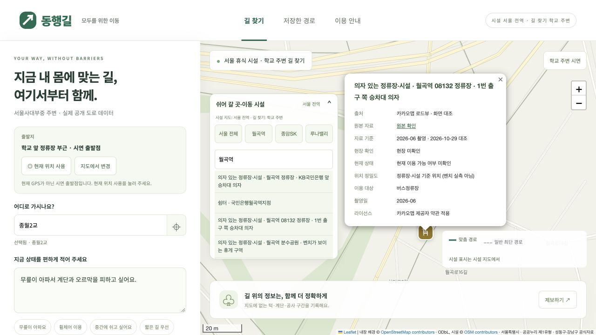

# 월곡역 추가 수색 검증 · 2026-10-29

- 새 휴게 위치 3곳: 월곡역 08132 승차대, 분수공원 벤치 구역, 동산어린이공원 달빛쉼터.
- 모두 월곡역 기준 직선 800m 안. bench 개별 좌표 증가 0; seating 1688→1691. 기존 KB국민은행 앞과 구분.
- 2026년 6월 로드뷰를 직접 확인하고 화면과 공유 링크 보존. 정류장 공식 좌표, 공원 경계, 촬영 지점이라는 서로 다른 위치 기준을 기록.
- 시설 데이터 검사 통과: 중복·잘못된 좌표 0. 기존 공식자료, 아파트 제보 보존. 반복 준비 실행 후 GeoJSON 해시 동일.
- 지도 배경 검사 통과: 외부 타일 요청 없음. 경로 검사 통과: 기존 최단 674m, 벤치 경유 958m.
- localhost에서 검색 결과와 신규 08132 팝업의 출처·촬영일·정밀도·현장 미확인을 화면 대조.
- 보름달빛쉼터, 숭곡초 입구, 정릉천 등의 정확한 개별 위치는 미확정. 누락 문제가 완전히 해결됐다고 주장하지 않음.

